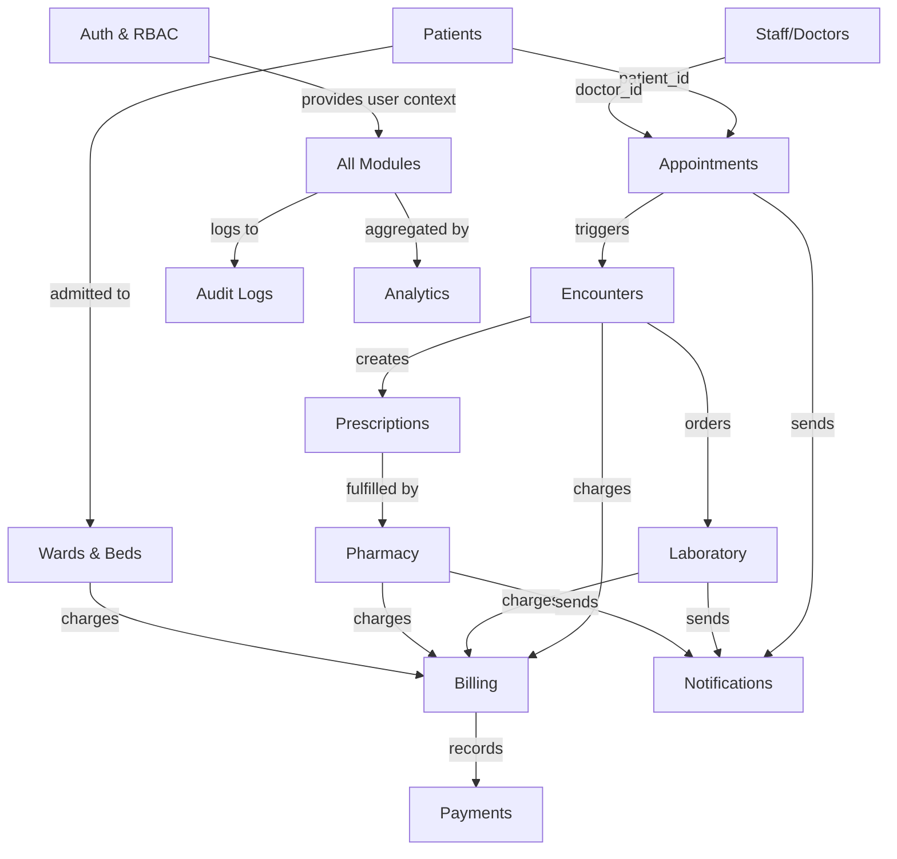

# Architecture

## 1. System Overview

**Product Name:** MedFlow HMS  
**Type:** Full-stack web application (modular monolith)  
**Architecture:** Client-server with REST API  
**Deployment:** Local development machine (Windows)

```
┌─────────────────────────────────────────────────────┐
│                   Browser (SPA)                     │
│  React 18 + TypeScript + Vite                       │
│  Shadcn/ui + Tailwind CSS + Recharts                │
├─────────────────────────────────────────────────────┤
│                 HTTP / REST API                      │
├─────────────────────────────────────────────────────┤
│               FastAPI (Python 3.13)                  │
│  SQLAlchemy ORM + Alembic Migrations                │
│  Pydantic Validation + JWT Auth                     │
├─────────────────────────────────────────────────────┤
│              SQLite (WAL mode)                       │
│        medflow.db (single file)                     │
└─────────────────────────────────────────────────────┘
```

## 2. Technology Stack

### Frontend

| Concern | Choice | Rationale |
|---------|--------|-----------|
| Framework | React 18 | Mature ecosystem, excellent tooling, strong community |
| Language | TypeScript | Type safety, better IDE support, fewer runtime errors |
| Build tool | Vite | Fast HMR, simple config, excellent DX |
| UI components | shadcn/ui | High-quality, accessible, copy-paste components built on Radix UI |
| Styling | Tailwind CSS 3 | Required by shadcn/ui; utility-first approach prevents style conflicts |
| Icons | Lucide React | Consistent, tree-shakeable icon library (used by shadcn/ui) |
| Charts | Recharts | React-native charting, composable, good documentation |
| Forms | React Hook Form + Zod | Performant form handling with schema-based validation |
| HTTP client | Axios | Interceptors for auth tokens, consistent error handling |
| Routing | React Router v6 | Standard SPA routing with nested layouts |
| State management | React Context + useReducer | Sufficient for this scope; no Redux overhead needed |
| Date handling | date-fns | Lightweight, tree-shakeable, immutable date utilities |
| Table | TanStack Table | Headless, powerful sorting/filtering/pagination |
| Toast notifications | Sonner | Lightweight, accessible toast component |
| Print | react-to-print | Clean print-friendly output for prescriptions, invoices, reports |

### Backend

| Concern | Choice | Rationale |
|---------|--------|-----------|
| Framework | FastAPI | Async-capable, auto-generated OpenAPI docs, Pydantic integration |
| Language | Python 3.13 | Available on system, extensive library ecosystem |
| ORM | SQLAlchemy 2.0 | Industry standard, supports multiple DB dialects, relationship modeling |
| Migrations | Alembic | Standard migration tool for SQLAlchemy |
| Validation | Pydantic v2 | Deep FastAPI integration, runtime type checking, schema generation |
| Authentication | python-jose (JWT) + passlib (bcrypt) | Stateless JWT tokens, industry-standard password hashing |
| CORS | FastAPI CORSMiddleware | Built-in, configurable |
| Testing | pytest + httpx | Standard Python testing with async HTTP client |
| Seed data | Custom Python script | Reproducible demo data generation |
| Environment config | python-dotenv | Load .env files for configuration |
| Logging | Python stdlib logging | No external dependency needed |

### Database

| Concern | Choice | Rationale |
|---------|--------|-----------|
| RDBMS | SQLite 3 (WAL mode) | Zero-install, single-file, Python built-in |
| Future migration | PostgreSQL | SQLAlchemy abstracts dialect; connection string swap |

### Development Tools

| Concern | Choice | Rationale |
|---------|--------|-----------|
| Version control | Git | Available on system |
| Package manager (Python) | pip + venv | Standard, no extra install |
| Package manager (JS) | npm | Available on system |
| API documentation | Swagger UI (built into FastAPI) | Auto-generated at /docs |
| Code formatting | Prettier (frontend), Black (backend) | Consistent code style |

## 3. Project Structure

```
hopital managment/
├── docs/                          # Planning documents (this folder)
│   ├── PROJECT_ASSESSMENT.md
│   ├── ARCHITECTURE.md
│   ├── DATABASE_DESIGN.md
│   ├── API_SPECIFICATION.md
│   ├── UI_UX_SPECIFICATION.md
│   ├── IMPLEMENTATION_PLAN.md
│   ├── TEST_PLAN.md
│   ├── GEMINI_IMPLEMENTATION_PROMPT.md
│   └── DECISIONS_AND_ASSUMPTIONS.md
│
├── backend/                       # FastAPI application
│   ├── alembic/                   # Database migration scripts
│   │   ├── versions/              # Individual migration files
│   │   ├── env.py
│   │   └── script.mako
│   ├── alembic.ini
│   ├── app/
│   │   ├── __init__.py
│   │   ├── main.py               # FastAPI app entry point
│   │   ├── config.py             # Settings and environment config
│   │   ├── database.py           # SQLAlchemy engine and session
│   │   ├── dependencies.py       # Shared FastAPI dependencies
│   │   │
│   │   ├── models/               # SQLAlchemy ORM models
│   │   │   ├── __init__.py
│   │   │   ├── user.py           # User, Role
│   │   │   ├── patient.py        # Patient, EmergencyContact
│   │   │   ├── staff.py          # Staff, Department, DoctorAvailability
│   │   │   ├── appointment.py    # Appointment
│   │   │   ├── encounter.py      # Encounter, Vitals, Diagnosis
│   │   │   ├── prescription.py   # Prescription, PrescriptionItem
│   │   │   ├── pharmacy.py       # Medicine, MedicineBatch, StockMovement
│   │   │   ├── laboratory.py     # LabTest, LabOrder, LabSample, LabResult
│   │   │   ├── ward.py           # Ward, Bed, Admission
│   │   │   ├── billing.py        # Invoice, InvoiceItem, Payment
│   │   │   ├── notification.py   # Notification
│   │   │   └── audit.py          # AuditLog
│   │   │
│   │   ├── schemas/              # Pydantic request/response schemas
│   │   │   ├── __init__.py
│   │   │   ├── auth.py
│   │   │   ├── patient.py
│   │   │   ├── staff.py
│   │   │   ├── appointment.py
│   │   │   ├── encounter.py
│   │   │   ├── prescription.py
│   │   │   ├── pharmacy.py
│   │   │   ├── laboratory.py
│   │   │   ├── ward.py
│   │   │   ├── billing.py
│   │   │   ├── notification.py
│   │   │   └── audit.py
│   │   │
│   │   ├── routers/              # API route handlers
│   │   │   ├── __init__.py
│   │   │   ├── auth.py
│   │   │   ├── patients.py
│   │   │   ├── staff.py
│   │   │   ├── departments.py
│   │   │   ├── appointments.py
│   │   │   ├── encounters.py
│   │   │   ├── prescriptions.py
│   │   │   ├── pharmacy.py
│   │   │   ├── laboratory.py
│   │   │   ├── wards.py
│   │   │   ├── admissions.py
│   │   │   ├── billing.py
│   │   │   ├── notifications.py
│   │   │   ├── analytics.py
│   │   │   └── audit.py
│   │   │
│   │   ├── services/             # Business logic layer
│   │   │   ├── __init__.py
│   │   │   ├── auth_service.py
│   │   │   ├── patient_service.py
│   │   │   ├── appointment_service.py
│   │   │   ├── encounter_service.py
│   │   │   ├── prescription_service.py
│   │   │   ├── pharmacy_service.py
│   │   │   ├── laboratory_service.py
│   │   │   ├── ward_service.py
│   │   │   ├── billing_service.py
│   │   │   ├── notification_service.py
│   │   │   └── audit_service.py
│   │   │
│   │   ├── middleware/           # Custom middleware
│   │   │   ├── __init__.py
│   │   │   └── error_handler.py
│   │   │
│   │   └── utils/               # Utility functions
│   │       ├── __init__.py
│   │       ├── security.py      # Password hashing, JWT
│   │       ├── permissions.py   # Role-based permission checks
│   │       └── helpers.py       # Shared utility functions
│   │
│   ├── tests/                   # Backend tests
│   │   ├── __init__.py
│   │   ├── conftest.py          # Shared fixtures
│   │   ├── test_auth.py
│   │   ├── test_patients.py
│   │   ├── test_appointments.py
│   │   ├── test_encounters.py
│   │   ├── test_prescriptions.py
│   │   ├── test_pharmacy.py
│   │   ├── test_laboratory.py
│   │   ├── test_wards.py
│   │   ├── test_billing.py
│   │   └── test_security.py
│   │
│   ├── seed.py                  # Demo data seeder
│   ├── requirements.txt         # Python dependencies
│   └── .env.example             # Environment template
│
├── frontend/                    # React + Vite application
│   ├── public/
│   │   └── favicon.svg
│   ├── src/
│   │   ├── main.tsx             # App entry point
│   │   ├── App.tsx              # Root component with routing
│   │   ├── index.css            # Global styles and Tailwind directives
│   │   │
│   │   ├── api/                 # API client and service functions
│   │   │   ├── client.ts        # Axios instance with interceptors
│   │   │   ├── auth.ts
│   │   │   ├── patients.ts
│   │   │   ├── staff.ts
│   │   │   ├── appointments.ts
│   │   │   ├── encounters.ts
│   │   │   ├── prescriptions.ts
│   │   │   ├── pharmacy.ts
│   │   │   ├── laboratory.ts
│   │   │   ├── wards.ts
│   │   │   ├── billing.ts
│   │   │   ├── notifications.ts
│   │   │   └── analytics.ts
│   │   │
│   │   ├── components/          # Reusable UI components
│   │   │   ├── ui/              # shadcn/ui components
│   │   │   ├── layout/          # Layout components
│   │   │   │   ├── AppLayout.tsx
│   │   │   │   ├── Sidebar.tsx
│   │   │   │   ├── TopBar.tsx
│   │   │   │   └── Breadcrumbs.tsx
│   │   │   ├── shared/          # Shared domain components
│   │   │   │   ├── DataTable.tsx
│   │   │   │   ├── StatusBadge.tsx
│   │   │   │   ├── SearchInput.tsx
│   │   │   │   ├── EmptyState.tsx
│   │   │   │   ├── LoadingState.tsx
│   │   │   │   ├── ConfirmDialog.tsx
│   │   │   │   ├── PrintButton.tsx
│   │   │   │   └── DateRangePicker.tsx
│   │   │   └── charts/          # Chart components
│   │   │       ├── BarChart.tsx
│   │   │       ├── LineChart.tsx
│   │   │       ├── PieChart.tsx
│   │   │       └── MetricCard.tsx
│   │   │
│   │   ├── contexts/            # React contexts
│   │   │   ├── AuthContext.tsx
│   │   │   └── NotificationContext.tsx
│   │   │
│   │   ├── hooks/               # Custom hooks
│   │   │   ├── useAuth.ts
│   │   │   ├── useDebounce.ts
│   │   │   └── usePagination.ts
│   │   │
│   │   ├── pages/               # Page components (by module)
│   │   │   ├── auth/
│   │   │   │   └── LoginPage.tsx
│   │   │   ├── dashboard/
│   │   │   │   ├── AdminDashboard.tsx
│   │   │   │   ├── DoctorDashboard.tsx
│   │   │   │   ├── ReceptionistDashboard.tsx
│   │   │   │   ├── NurseDashboard.tsx
│   │   │   │   ├── PharmacistDashboard.tsx
│   │   │   │   ├── LabTechDashboard.tsx
│   │   │   │   └── PatientDashboard.tsx
│   │   │   ├── patients/
│   │   │   ├── staff/
│   │   │   ├── appointments/
│   │   │   ├── encounters/
│   │   │   ├── prescriptions/
│   │   │   ├── pharmacy/
│   │   │   ├── laboratory/
│   │   │   ├── wards/
│   │   │   ├── billing/
│   │   │   ├── notifications/
│   │   │   ├── analytics/
│   │   │   └── audit/
│   │   │
│   │   ├── lib/                 # Utility functions
│   │   │   ├── utils.ts         # cn() helper and shared utilities
│   │   │   ├── constants.ts     # Enums, status values, role definitions
│   │   │   └── formatters.ts    # Date, currency, number formatters
│   │   │
│   │   └── types/               # TypeScript type definitions
│   │       ├── auth.ts
│   │       ├── patient.ts
│   │       ├── staff.ts
│   │       ├── appointment.ts
│   │       ├── encounter.ts
│   │       ├── prescription.ts
│   │       ├── pharmacy.ts
│   │       ├── laboratory.ts
│   │       ├── ward.ts
│   │       ├── billing.ts
│   │       ├── notification.ts
│   │       └── common.ts
│   │
│   ├── components.json          # shadcn/ui config
│   ├── tailwind.config.js       # Tailwind configuration
│   ├── tsconfig.json
│   ├── vite.config.ts
│   ├── package.json
│   └── index.html
│
├── scripts/                     # Development scripts
│   ├── setup.ps1                # One-command project setup (Windows)
│   ├── start.ps1                # Start both servers
│   └── reset-db.ps1             # Reset database and reseed
│
├── .gitignore
├── .env.example                 # Root environment template
└── README.md                    # Project overview and quick start
```

## 4. Module Boundaries

Each functional module follows a consistent three-layer architecture:

```
Router (HTTP layer) → Service (business logic) → Model/ORM (data access)
   ↑                      ↑                          ↑
Pydantic schemas     Validation &              SQLAlchemy models
for request/response  orchestration              & queries
```

### Module Dependency Map



### Cross-Module Communication Rules

1. Modules communicate only through their service layer — never by directly querying another module's models.
2. The service layer receives a database session from the router via FastAPI dependency injection.
3. Cross-module writes happen within a single database transaction managed by the router.
4. Notification creation is a side effect triggered by service methods, not a separate HTTP call.
5. Audit logging is performed via a utility function called within service methods.

## 5. Authentication Architecture

```
┌─────────┐     POST /api/auth/login      ┌─────────┐
│ Browser  │ ──────────────────────────────→│ FastAPI  │
│          │     { email, password }        │         │
│          │←──────────────────────────────│         │
│          │  { access_token, user, role } │         │
│          │                               │         │
│          │  GET /api/patients            │         │
│          │  Authorization: Bearer <jwt>   │         │
│          │ ──────────────────────────────→│         │
│          │     Verify JWT → Extract user  │         │
│          │     Check role permissions     │         │
│          │←──────────────────────────────│         │
│          │     { data } or 403           │         │
└─────────┘                               └─────────┘
```

- **Token type:** JWT (access token only; no refresh token for simplicity in academic version)
- **Token lifetime:** 8 hours (suitable for a full work shift)
- **Token storage:** localStorage (acceptable for local academic app; document that HttpOnly cookies are preferred in production)
- **Password hashing:** bcrypt via passlib
- **Token claims:** `sub` (user_id), `role`, `exp`, `iat`

## 6. Authorization Matrix

| Action | Admin | Doctor | Receptionist | Nurse | Pharmacist | Lab Tech | Patient |
|--------|-------|--------|-------------|-------|------------|----------|---------|
| Manage users/roles | ✅ | ❌ | ❌ | ❌ | ❌ | ❌ | ❌ |
| Manage departments | ✅ | ❌ | ❌ | ❌ | ❌ | ❌ | ❌ |
| View all patients | ✅ | ✅ | ✅ | ✅ | ❌ | ❌ | ❌ |
| Register patient | ✅ | ❌ | ✅ | ❌ | ❌ | ❌ | ❌ |
| Edit patient info | ✅ | ❌ | ✅ | ❌ | ❌ | ❌ | Own |
| View patient records | ✅ | Assigned | ❌ | Assigned | ❌ | ❌ | Own |
| Manage staff | ✅ | ❌ | ❌ | ❌ | ❌ | ❌ | ❌ |
| Create appointment | ✅ | ✅ | ✅ | ❌ | ❌ | ❌ | Own |
| View appointments | ✅ | Own | ✅ | ✅ | ❌ | ❌ | Own |
| Check-in patient | ✅ | ❌ | ✅ | ✅ | ❌ | ❌ | ❌ |
| Create encounter | ❌ | ✅ | ❌ | ❌ | ❌ | ❌ | ❌ |
| Record vitals | ❌ | ✅ | ❌ | ✅ | ❌ | ❌ | ❌ |
| Create prescription | ❌ | ✅ | ❌ | ❌ | ❌ | ❌ | ❌ |
| View prescriptions | ✅ | ✅ | ❌ | ✅ | ✅ | ❌ | Own |
| Dispense medicine | ❌ | ❌ | ❌ | ❌ | ✅ | ❌ | ❌ |
| Manage pharmacy stock | ✅ | ❌ | ❌ | ❌ | ✅ | ❌ | ❌ |
| Order lab tests | ❌ | ✅ | ❌ | ❌ | ❌ | ❌ | ❌ |
| Process lab samples | ❌ | ❌ | ❌ | ❌ | ❌ | ✅ | ❌ |
| Enter lab results | ❌ | ❌ | ❌ | ❌ | ❌ | ✅ | ❌ |
| Review lab results | ❌ | ✅ | ❌ | ❌ | ❌ | ✅ | ❌ |
| View lab results | ✅ | ✅ | ❌ | ✅ | ❌ | ✅ | Own |
| Manage wards/beds | ✅ | ❌ | ❌ | ✅ | ❌ | ❌ | ❌ |
| Admit/discharge | ✅ | ✅ | ✅ | ✅ | ❌ | ❌ | ❌ |
| Create invoices | ✅ | ❌ | ✅ | ❌ | ❌ | ❌ | ❌ |
| Record payments | ✅ | ❌ | ✅ | ❌ | ❌ | ❌ | ❌ |
| View invoices | ✅ | ❌ | ✅ | ❌ | ❌ | ❌ | Own |
| View analytics | ✅ | Own | Limited | Limited | Own | Own | ❌ |
| View audit logs | ✅ | ❌ | ❌ | ❌ | ❌ | ❌ | ❌ |
| Manage notifications | ✅ | Own | Own | Own | Own | Own | Own |

**"Assigned"** = Doctor/Nurse can only access records of patients they are assigned to via appointments or admissions.  
**"Own"** = Can only access their own records.  
**"Limited"** = Role-relevant metrics only (e.g., Receptionist sees appointment stats, not financial details).

## 7. Error Handling Strategy

### Backend Error Response Format

All API errors return a consistent JSON structure:

```json
{
  "detail": {
    "code": "APPOINTMENT_CONFLICT",
    "message": "The selected time slot is already booked.",
    "field": "scheduled_time",
    "context": {
      "conflicting_appointment_id": "APT-0042"
    }
  }
}
```

### HTTP Status Code Convention

| Code | Usage |
|------|-------|
| 200 | Successful retrieval or update |
| 201 | Successful creation |
| 204 | Successful deletion |
| 400 | Validation error or bad request |
| 401 | Missing or invalid authentication |
| 403 | Authenticated but insufficient permissions |
| 404 | Resource not found |
| 409 | Conflict (duplicate booking, occupied bed, etc.) |
| 422 | Pydantic validation failure (auto-generated by FastAPI) |
| 500 | Unexpected server error (logged, not exposed to client) |

### Frontend Error Handling

1. **Axios interceptors** catch 401 responses and redirect to login.
2. **Per-request error handling** displays contextual error messages via toast notifications.
3. **Form validation** uses Zod schemas that mirror backend Pydantic schemas.
4. **Network errors** display a generic connectivity message.
5. **Loading states** prevent duplicate submissions.

## 8. Security Boundaries

1. **No secrets in source code.** All secrets (JWT secret, database path) in `.env` files, which are `.gitignore`d.
2. **CORS restricted** to the frontend dev server origin (`http://localhost:5173`).
3. **SQL injection prevented** by SQLAlchemy parameterized queries — no raw SQL string concatenation.
4. **XSS mitigated** by React's default escaping and avoiding `dangerouslySetInnerHTML`.
5. **CSRF:** Not applicable for JWT-based stateless API (no cookies for auth).
6. **Rate limiting:** Optional middleware for login endpoint (5 attempts per minute per IP).
7. **Input validation:** Pydantic on backend, Zod on frontend — both enforce type, length, format.
8. **Audit trail:** All sensitive operations logged with actor, action, timestamp, and target.

## 9. Development Workflow

### Starting the Application

```powershell
# One-time setup
.\scripts\setup.ps1

# Start both servers (two terminal windows)
.\scripts\start.ps1
```

### URLs

| Service | URL |
|---------|-----|
| Frontend | http://localhost:5173 |
| Backend API | http://localhost:8000 |
| API Documentation | http://localhost:8000/docs |
| API ReDoc | http://localhost:8000/redoc |

### Database Operations

```powershell
# Run migrations
cd backend && python -m alembic upgrade head

# Seed demo data
cd backend && python seed.py

# Reset database
.\scripts\reset-db.ps1
```
