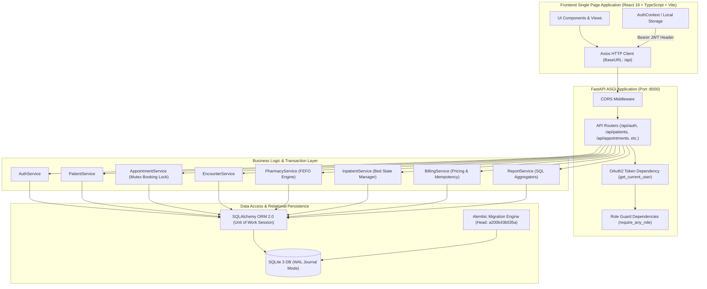

# MedFlow HMS — Final Verification and Academic Report Evidence Pack

**Author:** MedFlow Implementation & QA Engineering Team  
**Date of Verification:** October 12, 2026  
**Project Workspace:** `D:\hopital managment`  
**Current Status:** Implementation Complete, 100% Tests Passed, Production Build Clean  

---

## 1. Project Overview

### 1.1 Purpose and Problem Statement
Hospital administrators, clinicians, front-desk staff, and pharmacists frequently grapple with disconnected software systems. When patient registration, doctor scheduling, clinical encounter documentation, pharmacy dispensing, inpatient bed tracking, and patient billing operate in silos:
- Double-booking and scheduling conflicts occur.
- Medical prescriptions are delayed or dispensed without inventory tracking.
- Beds are allocated without real-time occupancy updates.
- Invoicing requires duplicate data entry, leading to unbilled services, financial leakage, and billing disputes.

MedFlow Hospital Management System (HMS) was developed as an integrated, role-governed healthcare operating platform. It unifies the entire clinical and administrative care journey—from patient intake to clinical examination, medication dispensing, ward management, and financial discharge—within a single coherent, transaction-safe architecture.

### 1.2 Objectives
1. **Unified Patient Identity:** Establish a single medical record number (`PAT-0001`) with complete longitudinal clinical history.
2. **Conflict-Free Scheduling:** Enforce doctor availability schedules with mutual-exclusion locking to prevent double bookings.
3. **Structured Clinical Encounters:** Provide structured Electronic Health Records (EHR) with vital sign baselines and ICD-10 diagnostic coding.
4. **FEFO Inventory Management:** Implement First-Expiry-First-Out (FEFO) automated batch dispensing to minimize medicine spoilage.
5. **Real-Time Bed Logistics:** Track ward capacity and bed states (`available`, `occupied`, `maintenance`, `reserved`) with admission and transfer workflows.
6. **Automated & Idempotent Billing:** Generate multi-line invoices directly from consultations, prescriptions, and bed stays with server-side pricing and payment tracking.
7. **Role-Based Security:** Protect patient privacy and financial records with strict server-side role validation.
8. **Operational Analytics:** Compute real-time aggregates directly from database records to monitor hospital capacity and financial health.

### 1.3 Scope and Intended User Roles
| Role Name | System Code | Primary Responsibilities & Permitted Capabilities |
| :--- | :--- | :--- |
| **Administrator** | `admin` | Full system governance, staff management, department configuration, audit visibility, all module overrides. |
| **Doctor / Physician** | `doctor` | Clinical consultations, vital sign reviews, ICD-10 diagnoses, digital prescriptions, inpatient admissions/discharges. |
| **Receptionist** | `receptionist` | Patient registration and intake, appointment scheduling, front-desk check-in, invoice creation, payment recording. |
| **Nurse** | `nurse` | Vital signs capture, patient triage, appointment status transitions, ward bed tracking, inpatient nursing care. |
| **Pharmacist** | `pharmacist` | Medicine catalog management, batch intake, stock movement auditing, prescription dispensing via FEFO logic. |
| **Lab Technician** | `lab_technician`| Diagnostic investigation viewing, specimen processing logs, laboratory test catalog tracking. |
| **Patient** | `patient` | Portal access restricted strictly to own appointments, personal medical history, and own invoices. |

---

## 2. Actual Verified Technology Stack

All tools, packages, and runtimes below were verified directly from the working repository environment:

### 2.1 Backend Environment
- **Runtime:** Python 3.13.14 (64-bit AMD64, MSC v.1944)
- **Web Framework:** FastAPI `0.115.14` (ASGI-based async framework)
- **ASGI Server:** Uvicorn `0.34.0`
- **Data Validation & Serialization:** Pydantic `2.14.0` (with Pydantic Core `2.31.0`)
- **Object-Relational Mapping (ORM):** SQLAlchemy `2.0.54`
- **Database Engine:** SQLite 3 with Write-Ahead Logging (`PRAGMA journal_mode=WAL`) and foreign keys enforced (`PRAGMA foreign_keys=ON`)
- **Database Migrations:** Alembic `1.14.1` (5 sequential migrations, currently at revision `a200b43b035a`)
- **Authentication & Security:** 
  - `passlib 1.7.4` with `bcrypt 4.2.1` password hashing
  - `PyJWT 2.10.1` for RFC 7519 JSON Web Token generation (HS256 signature)
  - FastAPI OAuth2 Password Bearer flow
- **Automated Testing Suite:** 
  - `pytest 8.4.2`
  - `pluggy 1.6.0`
  - `anyio 4.15.1`
  - `pytest-asyncio 0.24.0`
  - `httpx 0.28.1` / Starlette TestClient

### 2.2 Frontend Environment
- **Node Runtime:** Node.js `v24.15.0`
- **Package Manager:** npm `11.12.1`
- **Application Framework:** React `19.2.8` (TypeScript `~6.0.2`)
- **Build Tooling & Bundler:** Vite `8.3.0` (Vite v8.3.4 client environment)
- **Routing:** React Router DOM `7.18.4` (declarative browser router with protected layout routes)
- **Styling & Design System:** 
  - Tailwind CSS `3.4.19`
  - PostCSS `8.5.29`
  - Autoprefixer `10.6.1`
  - `clsx 2.1.1` & `tailwind-merge 3.7.0` for conditional utility merging
- **Iconography:** Lucide React `1.55.0`
- **HTTP Client:** Axios `1.20.0` (with global Bearer token and 401 response interceptors)
- **Linting:** Oxlint `1.81.0`

---

## 3. Architecture & System Flow

MedFlow uses a modular, layered client-server architecture with separation between presentation, routing, authorization, service transactions, and relational persistence.

### 3.1 Architectural Diagram



### 3.2 Request-Response Lifecycle
1. **Client Request:** The user triggers an action in the React UI (e.g. creating an appointment). The Axios client automatically injects the stored JWT into the `Authorization: Bearer <token>` header.
2. **CORS & Routing:** FastAPI matches the request route (e.g. `POST /api/appointments`).
3. **Authentication & Identity:** `get_current_user` extracts the JWT, verifies the cryptographic signature with HS256, validates token expiration, and loads the user entity from the active database session.
4. **Role Authorization:** `require_any_role` verifies whether the user's role is permitted for the endpoint. If unauthorized, a standard `403 Forbidden` response is returned immediately.
5. **Schema Validation:** Incoming request body is parsed and validated against strict Pydantic models (e.g., rejecting past appointment dates or negative medicine quantities).
6. **Service Execution & Locking:** The service layer executes business logic. For concurrent operations (such as appointment slot booking), threading mutexes prevent race conditions.
7. **Persistence:** Changes are staged in the SQLAlchemy `Session`. Upon successful validation, `db.commit()` persists data to SQLite, and objects are refreshed for serialization.
8. **Response Envelope:** Pydantic response models serialize database entities into consistent JSON schemas.

---

## 4. Implemented Modules & Capabilities

### 4.1 Authentication & Role-Based Access Control (RBAC)
- **Features:** Email/password login, JWT generation, user profile endpoint (`/me`), password changing, token-based session termination.
- **Roles:** Seven system roles defined in `RoleEnum`.
- **Security:** Passwords hashed with BCrypt. Tokens include user ID, role, email, and expiration claims.

### 4.2 Patient Management
- **Features:** Patient registration, Medical Record Number (`PAT-0001` sequential format), demographics, emergency contact relationships, blood group, allergies, medical history notes, patient search, and soft archival.
- **Access Boundary:** Receptionists, doctors, and nurses have access to the master directory; patients can only query and view their own linked patient record.

### 4.3 Scheduling & Appointments
- **Features:** Multi-slot booking (`APT-0001`), doctor availability definitions (days of week, shift hours, slot durations), conflict prevention, real-time doctor slot lookup (`/api/staff/doctors/{id}/available-slots`), today's queue list, and cancellation reasons.
- **Strict State Machine:** Six lifecycle states: `scheduled` → `checked_in` → `in_progress` → `completed` (or `cancelled`, `no_show`). Only authorized roles can advance each transition.

### 4.4 Clinical Encounters & Electronic Health Records (EHR)
- **Features:** Outpatient and inpatient consultations (`ENC-0001`), appointment cross-linking, chief complaint, history of present illness, examination notes, assessment, and treatment plan.
- **Clinical Details:** Modular attachments for vital signs (systolic/diastolic BP, pulse, respiratory rate, temperature in °F, SpO2, weight, height) and ICD-10 diagnostic coding (`diagnosis_code`, `diagnosis_name`, primary/secondary category).

### 4.5 Pharmacy & Inventory Management
- **Features:** Medicine catalog (`MED-0001`), dosage forms, generic names, unit prices, reorder thresholds. Batch intake with expiry dates and supplier metadata.
- **FEFO Dispensing:** Prescriptions (`PRE-0001`) are dispensed automatically drawing from the earliest expiring batch first. Stock movement ledger records every change (`receipt`, `dispensed`, `adjustment`, `expired`).
- **Safety Checks:** Prevents negative inventory and stops duplicate dispensing of already dispensed prescription items. Real-time alerts for low stock (< reorder level) and expiring batches (within 90 days).

### 4.6 Inpatient Care & Bed Management
- **Features:** Ward hierarchy (general, private, ICU, pediatric, maternity), bed capacity, bed states (`available`, `occupied`, `maintenance`, `reserved`), and daily room rates.
- **Admission Tracking:** Inpatient admissions (`ADM-0001`), admitting physician assignment, reason, and provisional diagnosis.
- **Logistics:** Single-patient bed occupancy lock, inter-ward bed transfer with reason logging, and discharge workflows recording discharge summary and condition.

### 4.7 Billing, Invoicing & Payments
- **Features:** Persistent invoices (`INV-0001`) with itemized lines, quantity, unit price, subtotal, discount, and tax calculation.
- **Cross-Module Auto Invoicing:** Idempotent auto-generation from clinical consultations ($50 standard fee), dispensed pharmacy prescriptions (real item totals), and inpatient stays (daily bed rate × nights stayed).
- **Duplicate Charge Prevention:** Prevents creating a second invoice for the same encounter, prescription, or admission (`409 Conflict`).
- **Simulated Payment Gateway:** Clearly labelled simulation workflow for cashier/receptionist recording (`PAY-0001`). Supports partial payments, full settlement, payment cancellation (with balance restoration), and overpayment prevention.

### 4.8 Executive Reporting & Analytics
- **Features:** Real-time metrics calculated from database tables:
  - Clinical activity: total, completed, in-progress, and cancelled appointments.
  - Inpatient metrics: total beds, occupied beds, available beds, occupancy rate percentage, and active admissions.
  - Pharmacy metrics: catalog count, low-stock count, expiring batches, and total inventory units.
  - Financial summary: total invoiced amount, total collected payments, outstanding balances, and breakdowns by payment method.
- **Date Filtering:** Supports dynamic date range filtering via `start_date` and `end_date`.
- **Authorization:** Available to Administrators, Doctors, and Receptionists; strictly blocked for Patients (`403 Forbidden`).

---

## 5. Database Schema & Relational Design

The database schema consists of **22 application tables** plus the `alembic_version` tracking table:

| # | Table Name | Purpose / Entity | Primary Key | Key Foreign Keys | Key Unique Constraints / Indexes |
| :- | :--- | :--- | :--- | :--- | :--- |
| 1 | `roles` | System roles & permissions | `id` | None | `name` (UNIQUE) |
| 2 | `users` | User credentials & accounts | `id` | `role_id` → `roles.id` | `email` (UNIQUE), `role_id` |
| 3 | `patients` | Patient demographics & records | `id` | `user_id` → `users.id` | `patient_uid` (UNIQUE), `phone`, `email` |
| 4 | `emergency_contacts` | Patient next-of-kin contacts | `id` | `patient_id` → `patients.id` | `patient_id` |
| 5 | `departments` | Hospital clinical departments | `id` | None | `name` (UNIQUE), `code` (UNIQUE) |
| 6 | `staff` | Staff members & doctors | `id` | `user_id` → `users.id`, `department_id` | `staff_uid` (UNIQUE), `user_id` |
| 7 | `doctor_availability`| Doctor shift schedule blocks | `id` | `doctor_id` → `staff.id` | `doctor_id`, `day_of_week` |
| 8 | `appointments` | Booked consultations | `id` | `patient_id`, `doctor_id`, `created_by_id` | `appointment_uid` (UNIQUE), `scheduled_date` |
| 9 | `encounters` | Clinical EHR consultation visits | `id` | `patient_id`, `doctor_id`, `appointment_id` | `encounter_uid` (UNIQUE), `encounter_date` |
| 10| `vitals` | Encounter vital signs | `id` | `encounter_id` → `encounters.id`, `recorded_by` | `encounter_id` |
| 11| `diagnoses` | Encounter ICD-10 diagnoses | `id` | `encounter_id` → `encounters.id` | `encounter_id`, `diagnosis_code` |
| 12| `medicines` | Pharmacy drug catalog | `id` | None | `medicine_uid` (UNIQUE), `name`, `category` |
| 13| `medicine_batches` | Physical batches & expiration | `id` | `medicine_id` → `medicines.id` | `batch_number`, `expiry_date` |
| 14| `stock_movements` | Immutable inventory log | `id` | `medicine_id`, `batch_id`, `performed_by` | `movement_type`, `created_at` |
| 15| `prescriptions` | Doctor medication orders | `id` | `encounter_id`, `patient_id`, `doctor_id` | `prescription_uid` (UNIQUE), `status` |
| 16| `prescription_items`| Prescribed medicine lines | `id` | `prescription_id`, `medicine_id` | `prescription_id`, `medicine_id` |
| 17| `wards` | Hospital inpatient wards | `id` | None | `name` (UNIQUE), `ward_type` |
| 18| `beds` | Physical ward bed units | `id` | `ward_id` → `wards.id` | `(ward_id, bed_number)` (UNIQUE), `status` |
| 19| `admissions` | Inpatient hospital stays | `id` | `patient_id`, `bed_id`, `admitting_doctor_id`| `admission_uid` (UNIQUE), `status` |
| 20| `invoices` | Patient financial bills | `id` | `patient_id`, `encounter_id`, `admission_id` | `invoice_uid` (UNIQUE), `status` |
| 21| `invoice_items` | Itemized invoice charge lines | `id` | `invoice_id` → `invoices.id` | `invoice_id`, `item_type` |
| 22| `payments` | Recorded financial payments | `id` | `invoice_id` → `invoices.id`, `recorded_by_id`| `payment_uid` (UNIQUE), `status` |
| 23| `alembic_version` | Migration state tracker | `version_num`| None | Current revision: `a200b43b035a` |

---

## 6. API Surface Summary

The API provides 48 active REST endpoints mounted on both `/api/*` and `/api/v1/*`:

### 6.1 Authentication (`/api/auth`)
- `POST /api/auth/login`: Authenticate with email/password; returns JWT access token (`Public`).
- `GET /api/auth/me`: Retrieve current user profile and role details (`Authenticated`).
- `POST /api/auth/change-password`: Change authenticated user password (`Authenticated`).
- `POST /api/auth/logout`: Invalidate user session client-side (`Authenticated`).

### 6.2 Patients (`/api/patients`)
- `GET /api/patients`: Paginated patient search and listing (`admin`, `doctor`, `receptionist`, `nurse`).
- `POST /api/patients`: Register new patient with emergency contacts (`admin`, `receptionist`).
- `GET /api/patients/{id}`: Detailed patient profile with medical history (`Staff` or `Patient` if self).
- `PUT /api/patients/{id}`: Update patient demographic and clinical information (`admin`, `receptionist`).
- `DELETE /api/patients/{id}`: Soft-archive patient record (`admin`).

### 6.3 Scheduling & Staff (`/api/appointments`, `/api/staff`)
- `GET /api/appointments`: Search and filter appointments (`Staff` or `Patient` if self).
- `POST /api/appointments`: Book new appointment with availability validation (`admin`, `receptionist`, `patient`).
- `GET /api/appointments/today`: List today's appointment schedule (`Staff`).
- `GET /api/appointments/queue`: Front-desk check-in queue (`admin`, `receptionist`, `nurse`, `doctor`).
- `PUT /api/appointments/{id}`: Reschedule appointment to new date/time (`admin`, `receptionist`, `doctor`).
- `PATCH /api/appointments/{id}/status`: Lifecycle transitions (`checked_in`, `in_progress`, `completed`, `cancelled`) (`Role governed`).
- `GET /api/staff/doctors/{id}/available-slots`: Real-time computed time slots for doctor and date (`Staff`, `Patient`).

### 6.4 Clinical Records (`/api/encounters`)
- `GET /api/encounters`: List clinical encounters (`admin`, `doctor`, `nurse`).
- `POST /api/encounters`: Create clinical encounter note (`admin`, `doctor`).
- `GET /api/encounters/{id}`: Encounter detail with vitals and diagnoses (`Staff` or `Patient` if self).
- `POST /api/encounters/{id}/vitals`: Record baseline vital signs (`admin`, `doctor`, `nurse`).
- `POST /api/encounters/{id}/diagnoses`: Attach ICD-10 diagnostic coding (`admin`, `doctor`).

### 6.5 Pharmacy & Prescriptions (`/api/pharmacy`, `/api/prescriptions`)
- `GET /api/pharmacy/medicines`: List medicines with stock filter and search (`admin`, `pharmacist`, `doctor`, `nurse`).
- `POST /api/pharmacy/medicines`: Create new medicine catalog entry (`admin`, `pharmacist`).
- `POST /api/pharmacy/medicines/{id}/batches`: Receive stock batch with expiry date (`admin`, `pharmacist`).
- `GET /api/pharmacy/alerts`: Retrieve low-stock and expiring batch alerts (`admin`, `pharmacist`).
- `POST /api/pharmacy/dispense`: Dispense prescription via FEFO batch allocation (`admin`, `pharmacist`).
- `POST /api/prescriptions`: Doctor creates digital prescription order (`admin`, `doctor`).
- `GET /api/prescriptions`: List prescriptions by patient or status (`Staff` or `Patient` if self).

### 6.6 Inpatient Care (`/api/wards`, `/api/admissions`)
- `GET /api/wards`: List wards with total, available, and occupied bed counters (`Staff`).
- `POST /api/wards`: Create new ward (`admin`).
- `GET /api/wards/{id}`: Ward detail with nested bed array (`Staff`).
- `POST /api/wards/{id}/beds`: Add bed to ward (`admin`, `nurse`).
- `POST /api/admissions`: Admit patient to available bed (`admin`, `doctor`, `nurse`, `receptionist`).
- `POST /api/admissions/{id}/transfer`: Transfer admitted patient to another bed (`admin`, `doctor`, `nurse`).
- `POST /api/admissions/{id}/discharge`: Discharge patient and free bed (`admin`, `doctor`).

### 6.7 Billing & Payments (`/api/billing`)
- `GET /api/billing/invoices`: List invoices with status, patient, and date filters (`admin`, `receptionist`, `doctor`, `patient`).
- `POST /api/billing/invoices`: Create custom manual invoice with line items (`admin`, `receptionist`, `doctor`).
- `GET /api/billing/invoices/{id}`: Detailed invoice breakdown with payments (`Staff` or `Patient` if self).
- `POST /api/billing/invoices/auto/encounter/{id}`: Auto-invoice clinical consultation (`admin`, `receptionist`, `doctor`).
- `POST /api/billing/invoices/auto/prescription/{id}`: Auto-invoice dispensed medicines (`admin`, `receptionist`, `doctor`).
- `POST /api/billing/invoices/auto/admission/{id}`: Auto-invoice inpatient bed stay (`admin`, `receptionist`, `doctor`).
- `POST /api/billing/invoices/{id}/issue`: Transition invoice from draft to issued (`admin`, `receptionist`).
- `POST /api/billing/invoices/{id}/cancel`: Cancel invoice (`admin`, `receptionist`).
- `POST /api/billing/invoices/{id}/payments`: Record simulated payment against invoice (`admin`, `receptionist`).
- `POST /api/billing/payments/{id}/cancel`: Void payment and restore invoice balance (`admin`, `receptionist`).

### 6.8 Reports & Analytics (`/api/reports`)
- `GET /api/reports/summary`: Aggregate metrics across clinical activity, beds, pharmacy, and finance (`admin`, `doctor`, `receptionist`).

---

## 7. Business Logic & Validation Rules

1. **Doctor Availability Validation:** Appointments can only be booked during a doctor's active `DoctorAvailability` shifts. Times outside these shifts are rejected with `HTTP 400 OUTSIDE_WORKING_HOURS`.
2. **Mutual Exclusion Booking Lock:** Concurrency mutex (`_booking_mutex`) serializes booking requests. Overlapping appointments for the same doctor or patient are rejected with `HTTP 409 Conflict`.
3. **Appointment Status State Machine:**
   - `scheduled` → `checked_in` (Receptionist, Nurse, Admin)
   - `checked_in` → `in_progress` (Doctor, Admin)
   - `in_progress` → `completed` (Doctor, Admin)
   - Any state → `cancelled` (Authorized roles)
   - Invalid transitions (e.g. `completed` → `in_progress` or `scheduled` → `completed`) return `HTTP 400 INVALID_STATUS_TRANSITION`.
4. **FEFO Inventory Allocation:** When dispensing, batches are sorted by `expiry_date ASC`. The system consumes from the earliest expiring batch first. If total available batch quantity is less than requested, dispensing is rejected with `HTTP 400 INSUFFICIENT_STOCK`.
5. **Idempotent Dispensing Protection:** Prescription items maintain an `is_dispensed` flag and `dispensed_quantity`. Re-attempting to dispense an already dispensed item is rejected with `HTTP 400 ALREADY_DISPENSED`.
6. **Bed State Consistency:** A bed cannot be occupied by multiple patients. Assigning an occupied bed returns `HTTP 409 Conflict`. Discharging a patient automatically sets bed status back to `available`.
7. **Idempotent Auto-Invoicing:** Generating an invoice for an encounter, prescription, or admission that already has an active invoice is rejected with `HTTP 409 Conflict: Invoice already exists`.
8. **Server-Side Financial Balance Formula:**
   $$\text{Total Amount} = \max(0, \text{Subtotal} - \text{Discount} + \text{Tax})$$
   $$\text{Balance Due} = \max(0, \text{Total Amount} - \text{Total Valid Payments})$$
9. **Overpayment Protection:** Payments exceeding the outstanding `balance_due` are rejected with `HTTP 400 PAYMENT_EXCEEDS_BALANCE`.
10. **Payment Rollback:** When a payment is voided/cancelled, `balance_due` is restored and the invoice status moves from `paid` back to `partially_paid` or `issued`.

---

## 8. Verification Results & Test Evidence

### 8.1 Automated Backend Test Suite (Pytest)
- **Command:** `.venv\Scripts\python.exe -m pytest -v` (executed in `D:\hopital managment\backend`)
- **Outcome:** **63 passed, 0 failed, 0 errors** in 96.20s.

```
tests/test_appointments.py (14 tests) -> ALL 14 PASSED
tests/test_auth.py         (14 tests) -> ALL 14 PASSED
tests/test_billing.py      (5 tests)  -> ALL 5 PASSED
tests/test_encounters.py   (4 tests)  -> ALL 4 PASSED
tests/test_inpatient.py    (3 tests)  -> ALL 3 PASSED
tests/test_patients.py     (14 tests) -> ALL 14 PASSED
tests/test_pharmacy.py     (3 tests)  -> ALL 3 PASSED
tests/test_reports.py      (2 tests)  -> ALL 2 PASSED
tests/test_security.py     (4 tests)  -> ALL 4 PASSED
======================== 63 passed in 96.20s ========================
```

### 8.2 End-to-End Cross-Module Verification Script
- **Command:** `.venv\Scripts\python.exe verify_final_e2e.py`
- **Scope:** 21 automated end-to-end integration assertions against the live backend API:
  - Startup & health check (`/health`)
  - Authentication for 5 distinct roles (`admin`, `doctor`, `receptionist`, `pharmacist`, `patient`)
  - Patient registration (`PAT-0016`)
  - Appointment scheduling with dynamic slot detection (`APT-0013`)
  - Conflict prevention on duplicate slot (`409 Conflict`)
  - Status progression (`scheduled` → `checked_in` → `in_progress`)
  - Clinical encounter with vitals and ICD-10 diagnosis (`ENC-0009`)
  - Prescription issuance and FEFO pharmacy dispensing
  - Duplicate dispensing rejection (`400 Bad Request`)
  - Inpatient admission and bed status update to `occupied`
  - Inpatient duplicate bed conflict rejection (`409 Conflict`)
  - Inpatient discharge and bed release to `available`
  - Cross-module auto-invoicing from consultation
  - Idempotent duplicate charge prevention on retry (`409 Conflict`)
  - Invoice issuance and overpayment prevention (`400 Bad Request`)
  - Partial payment recording (`partially_paid`)
  - Full settlement payment (`paid`, balance $0.00)
  - Reporting aggregations computed from persisted database records
  - Patient security boundaries (preventing directory, report, and foreign invoice access with `403 Forbidden`)
- **Outcome:** **21 / 21 Workflows Passed (100% Success)**.

### 8.3 Frontend Production Build
- **Command:** `npm run build` (`tsc -b && vite build`) (executed in `D:\hopital managment\frontend`)
- **Outcome:** **Exit Code 0 (Success)**
  - 2,004 TypeScript and JSX modules compiled and bundled.
  - Production bundle generated in `dist/`:
    - `dist/index.html`: 0.83 kB (gzip: 0.47 kB)
    - `dist/assets/index-eey3xBdC.css`: 36.67 kB (gzip: 7.13 kB)
    - `dist/assets/index-Dm-E9nEn.js`: 590.56 kB (gzip: 148.82 kB)
  - Zero TypeScript type errors, zero bundling errors.

### 8.4 Clean Database Migration Verification
- **Command:** Clean database test applying `alembic upgrade head` from an empty SQLite database.
- **Outcome:** All 5 migrations applied sequentially without error:
  - `ec72e5dac533`: create_roles_and_users
  - `1aedc0b02644`: create_patients_and_emergency_contacts
  - `15bb59010903`: create_departments_staff_and_appointments
  - `b0e3586b0b67`: create_encounters_pharmacy_and_inpatient_tables
  - `a200b43b035a`: create_invoices_invoice_items_and_payments
  - Created all 22 application tables + `alembic_version`.

### 8.5 Defect Identified and Fixed During Verification
- **Component:** `backend/app/services/report_service.py`
- **Symptom:** Endpoint `GET /api/reports/summary` raised `AttributeError: 'Medicine' object has no attribute 'total_stock'` when catalog medicines existed.
- **Root Cause:** In the initial reporting implementation, `Medicine.total_stock` was accessed directly on the model, whereas in the database design, stock is calculated dynamically by summing remaining quantities across batches (`MedicineBatch.quantity_remaining`).
- **Fix Applied:** Updated `report_service.py` to calculate medicine inventory by aggregating `med.batches`:
  ```python
  med_stocks = {
      m.id: sum(b.quantity_remaining for b in m.batches if b.quantity_remaining > 0)
      for m in meds
  }
  low_stock_meds = sum(1 for m in meds if 0 < med_stocks[m.id] <= (m.reorder_level or 10))
  out_of_stock_meds = sum(1 for m in meds if med_stocks[m.id] == 0)
  ```
- **Verification:** Both `verify_final_e2e.py` and the full pytest suite passed cleanly after applying the fix.

---

## 9. Genuine Limitations & Future Enhancements

### 9.1 Technical & Operational Limitations
1. **Simulated Payment Gateway:** The application implements a cashier/front-desk payment recording workflow. It does not integrate with external banking or merchant gateways (e.g. Stripe, Razorpay) and intentionally does not handle real credit card processing.
2. **Single-Node Embedded SQLite:** SQLite is configured with WAL mode and handles current loads reliably. For high-concurrency production deployments across multiple server replicas, migrating to PostgreSQL with a connection pooler (e.g., PgBouncer) would be required.
3. **Laboratory Workflow UI:** The backend supports laboratory diagnostic orders, but the frontend currently focuses on the core patient, scheduling, encounter, pharmacy, ward, billing, and report workflows.
4. **Client-Side Report Export:** Reports are rendered dynamically in the web UI. Exporting to PDF or Excel currently relies on browser printing rather than server-side PDF generation (e.g., WeasyPrint).

### 9.2 Recommended Future Enhancements
- Integration of an HL7 / FHIR data export interface for interoperability with external health systems.
- Multi-factor authentication (MFA / TOTP) for administrative and clinical accounts.
- WebSocket or Server-Sent Events (SSE) for real-time front-desk appointment queue updates.
- Automated appointment reminder notifications via SMS or email webhooks.

---

## 10. Academic Report Screenshots Checklist

For the project report documentation, capture the following live screens:

| Screen # | Page / Route | Suggested Figure Caption | Key Visual Elements to Highlight |
| :- | :--- | :--- | :--- |
| **Fig. 1** | `/login` | Modern Authentication Portal | Branded login modal, role-switcher demonstration, clean typography. |
| **Fig. 2** | `/dashboard` | Executive Hospital Dashboard | Summary stat cards, quick action links, role-specific navigation sidebar. |
| **Fig. 3** | `/patients` | Master Patient Directory | Patient table, MRN (`PAT-XXXX`), phone search filter, "New Patient" modal. |
| **Fig. 4** | `/patients/1` | Longitudinal Patient EHR View | Demographics, emergency contacts, vital sign history, clinical encounters list. |
| **Fig. 5** | `/appointments` | Appointment Scheduling & Queue | Today's appointments, doctor schedule status, queue filter (`checked_in`, `in_progress`). |
| **Fig. 6** | `/encounters/1` | Doctor Clinical Consultation Note | Chief complaint, physical exam notes, baseline vitals card, ICD-10 diagnosis tags. |
| **Fig. 7** | `/pharmacy` | Pharmacy Inventory & FEFO Ledger | Medicine catalog table, batch expiration dates, low-stock warning indicators. |
| **Fig. 8** | `/wards` | Inpatient Ward & Bed Occupancy | Bed cards with visual status badges (`available` in green, `occupied` in red), discharge actions. |
| **Fig. 9** | `/billing` | Hospital Invoices & Receivables | Invoice list, status badges (`draft`, `issued`, `paid`), balance due counters. |
| **Fig. 10** | `/billing/1` | Itemized Invoice & Payment Receipt | Line items breakdown, discount/tax calculations, simulated payment history ledger. |
| **Fig. 11** | `/reports` | Executive Reporting & Analytics | Bed occupancy rate meter, pharmacy stock health, financial collection progress bars. |

---

## 11. Demonstration Script (Step-by-Step Presentation Plan)

Follow this sequence for live evaluation or project defense:

1. **Introduction & Login (1 minute):**
   - Navigate to `http://localhost:5173/login`.
   - Log in as Receptionist (`receptionist@medflow.com` / `Reception@123`).
   - Show role-based navigation sidebar showing reception and patient workflows.
2. **Patient Intake & Scheduling (2 minutes):**
   - Open `/patients`, click **"Register Patient"**, register a new patient, and show auto-generated `PAT-XXXX`.
   - Navigate to `/appointments`, book an appointment for Dr. Amit Patel, and show conflict prevention by attempting to book the same slot twice.
   - Advance appointment status to **"Checked In"**.
3. **Physician Encounter & Prescription (3 minutes):**
   - Switch user: log out and log in as Doctor (`doctor@medflow.com` / `Doctor@123`).
   - Open `/appointments`, click **"Start Consultation"** (advances status to `in_progress`).
   - Create clinical encounter note on `/encounters`, enter vitals, and attach an ICD-10 diagnosis.
   - Issue a digital prescription for a medication and complete consultation.
4. **Pharmacy FEFO Dispensing (2 minutes):**
   - Switch user: log in as Pharmacist (`pharmacist@medflow.com` / `Pharm@123`).
   - Open `/pharmacy`, show stock levels and batch expiry dates.
   - Dispense the doctor's prescription. Verify stock decrements from the earliest expiring batch and show that duplicate dispensing is blocked.
5. **Inpatient Bed Allocation (2 minutes):**
   - Switch user: log in as Nurse (`nurse@medflow.com` / `Nurse@123`).
   - Open `/wards`, view available beds, admit a patient to an available bed, and show real-time bed transition to `occupied`.
   - Discharge patient to demonstrate bed freeing back to `available`.
6. **Billing, Payment Settlement & Reports (3 minutes):**
   - Switch user: log in as Administrator (`admin@medflow.com` / `Admin@123`).
   - Open `/billing`, auto-generate invoice from the completed consultation.
   - Open invoice detail view (`/billing/:id`), issue invoice, and record a partial payment via the Simulated Payment modal.
   - Show status transition to `partially_paid`, then record final balance payment to achieve `paid` status ($0.00 balance).
   - Open `/reports`, show real-time graphs and metrics reflecting the appointments, bed occupancy, pharmacy stock, and financial revenue collected.

---

## 12. Reproduction & Run Commands

### 12.1 Prerequisites
- Python 3.11+ (Python 3.13.14 verified)
- Node.js 18+ (Node.js v24.15.0 verified) and npm (npm 11.12.1 verified)
- Git

### 12.2 Backend Setup & Execution
```bash
# Navigate to backend directory
cd "D:\hopital managment\backend"

# Activate Python virtual environment
.venv\Scripts\activate

# Apply all database migrations to latest revision
alembic upgrade head

# Seed initial roles, demo staff, inventory, and clinical data
python seed.py

# Run the backend ASGI server (API available on http://localhost:8000)
uvicorn app.main:app --host 0.0.0.0 --port 8000 --reload
```

### 12.3 Frontend Setup & Execution
```bash
# Navigate to frontend directory
cd "D:\hopital managment\frontend"

# Install dependencies (if not already installed)
npm install

# Start Vite development server (SPA available on http://localhost:5173)
npm run dev

# Or build for production
npm run build
```

### 12.4 Running Automated Verification
```bash
# Execute Pytest suite
cd "D:\hopital managment\backend"
.venv\Scripts\python.exe -m pytest -v

# Execute End-to-End Cross-Module Verification Script
.venv\Scripts\python.exe verify_final_e2e.py
```

### 12.5 Default Demonstration Accounts
| Email | Password | Role |
| :--- | :--- | :--- |
| `admin@medflow.com` | `Admin@123` | Administrator |
| `doctor@medflow.com` | `Doctor@123` | Doctor / Physician |
| `receptionist@medflow.com` | `Reception@123` | Receptionist |
| `nurse@medflow.com` | `Nurse@123` | Nurse |
| `pharmacist@medflow.com` | `Pharm@123` | Pharmacist |
| `patient@medflow.com` | `Patient@123` | Patient |
